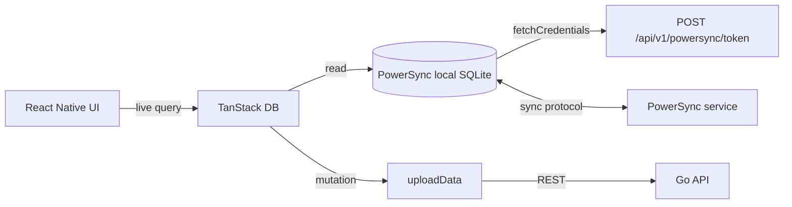

# Phase 3: Mobile cutover

[Phase 2](02-backend-token-bridge.md) made the service reachable with a backend-minted token and opened all tenant streams. This phase moves the mobile app onto it and retires the WatermelonDB stack.

**Today**

The app reads and writes WatermelonDB models through `mobile/lib/sync/client.ts` and `mobile/lib/sync/durableWrites.ts`. The client pulls and pushes through the legacy `/api/v1/sync` endpoints.

**Proposed**

The app uses the PowerSync React Native SDK with OP SQLite and TanStack DB. `fetchCredentials` calls `/api/v1/powersync/token`; `uploadData` posts to the existing REST endpoints. Live queries replace the WatermelonDB observables, and the models, migrations, and custom sync client are removed once every screen is migrated.



The connector hands the PowerSync SDK the endpoint and token from the API:

```ts
const connector = {
  fetchCredentials: async () => {
    const res = await api.post("/powersync/token");
    return { endpoint: res.powersync_url, token: res.token };
  },
};
```

```changes

```
