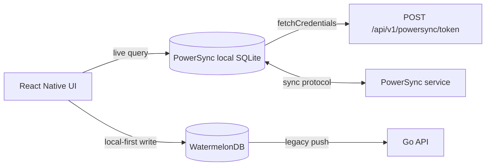

# Phase 3: Mobile cutover

[Phase 2](02-backend-token-bridge.md) made the service reachable with a backend-minted token and opened all tenant streams. This phase moves the mobile app onto it and retires the WatermelonDB stack.

**Status**

The read pilot is implemented behind `EXPO_PUBLIC_POWERSYNC_ENABLED=true`. The app still uses WatermelonDB for writes and as the fallback read path; PowerSync currently owns the products read path.

Implemented:

- Client schema for all 14 synced tables in `mobile/sync/powersync/schema.ts`.
- `fetchCredentials` connector calling `POST /api/v1/powersync/token` in `mobile/sync/powersync/connector.ts`.
- Platform-aware database (`@powersync/react-native` with OP-SQLite on native, `@powersync/web` with workers on Expo web) in `mobile/sync/powersync/database.ts`.
- Auth/business-scoped connection lifecycle in `mobile/sync/powersync/PowerSyncProvider.tsx`.
- Expo config for web workers, Metro platform resolution, async-iterator polyfill, and generated `public/@powersync` assets.
- `useProducts` reads products, variants, and inventory from PowerSync live queries and merges pending WatermelonDB rows so offline creates remain visible.
- Verified in Expo web with the legacy `/products` and `/sync` endpoints blocked; Android JS export also succeeds.

Remaining:

- Verify streaming and the first full sync on physical Android/iOS devices.
- Implement `uploadData` against the existing REST endpoints.
- Migrate the remaining domains to PowerSync live queries.
- Remove WatermelonDB models, migrations, and the custom sync client after parity.



The connector hands the PowerSync SDK the endpoint and token from the API, with an optional `EXPO_PUBLIC_POWERSYNC_URL` override for LAN/device development:

```ts
const connector = {
  fetchCredentials: async () => {
    const res = await api.post("/powersync/token");
    return { endpoint: res.data.powersync_url, token: res.data.token };
  },
};
```

```changes

```
