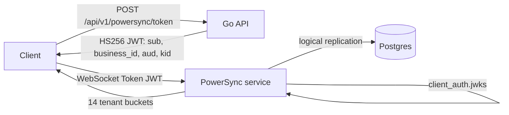

# PowerSync sync engine

## Problem overview

Bizworth's mobile app currently syncs through WatermelonDB and a hand-rolled client in `mobile/lib/sync/`. That stack is expensive to maintain and does not give us a general sync protocol. This branch replaces the engine with a self-hosted PowerSync service while keeping the Go REST API, Postgres, and Clerk for identity.

PowerSync needs a client credential it can verify itself. Sending Clerk tokens directly would require publishing Clerk's JWKS to the sync service and coupling the two auth systems. Instead, the Go API mints its own short-lived tokens for the authenticated user and business.

## Solution overview

The PowerSync service replicates from Postgres through a logical replication publication and slot. The Go API exposes `POST /api/v1/powersync/token`, which returns an HS256 JWT carrying the user and business. PowerSync verifies the JWT with a shared key in `client_auth.jwks`, then uses `auth.parameter('business_id')` to scope every sync stream.

All writes remain server-authoritative: PowerSync uploads call the existing Go REST endpoints. `payment_commands` is synced down for display but rejected on upload because payment state is owned by M-Pesa/STK callbacks.

## Goals

- Let the mobile client fetch a short-lived PowerSync token from the existing authenticated API.
- Verify PowerSync tokens without sharing Clerk keys with the sync service.
- Sync every tenant-owned table, scoped to the caller's `business_id`, and propagate soft deletes.
- Reject client uploads for server-owned payment state.
- Keep the change reversible: the legacy `/api/v1/sync` endpoints still work until the mobile cutover.

## Non-goals

- Replacing the mobile sync client yet; that is [Phase 3](03-mobile-cutover.md).
- Moving writes away from the Go REST API.
- PowerSync Cloud; the service is self-hosted in the existing compose stack.

## Pages

- [Phase 1: Self-hosted PowerSync service](01-self-hosted-service.md)
- [Phase 2: Backend-minted credentials and tenant streams](02-backend-token-bridge.md)
- [Phase 3: Mobile cutover](03-mobile-cutover.md)

## References

- `[[backend/internal/powersync/handler.go]]`
- `[[backend/internal/powersync/token.go]]`
- `[[backend/internal/shared/config/config.go]]`
- `[[backend/internal/shared/authz/authz.go]]`
- `[[backend/powersync/sync-config.yaml]]`
- `[[backend/powersync/service.prod.yaml]]`
- `[[backend/internal/sync/types.go]]`
- `[[backend/internal/sync/push.go]]`
- `[[backend/docker-compose.yml]]`
- `[[backend/Makefile]]`
- `[[mobile/sync/client.ts]]`
