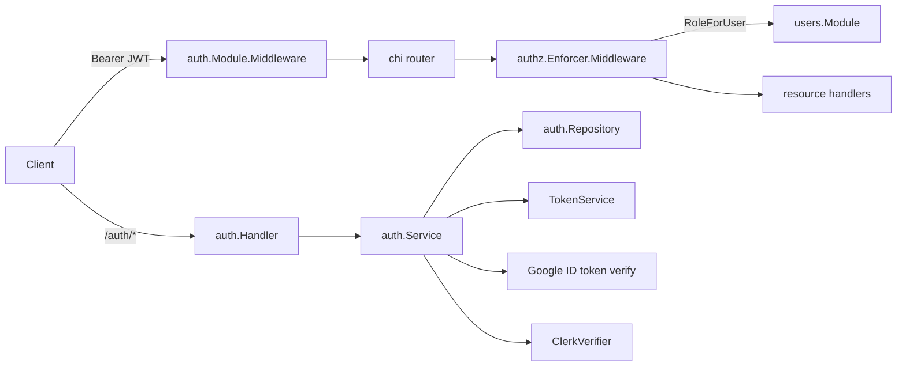
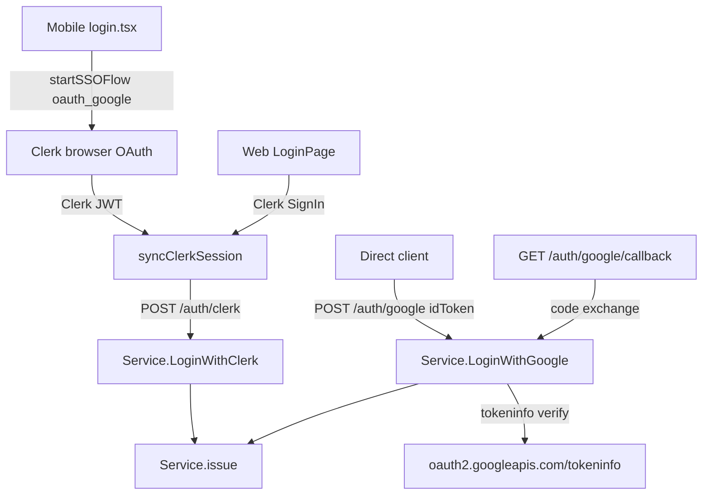
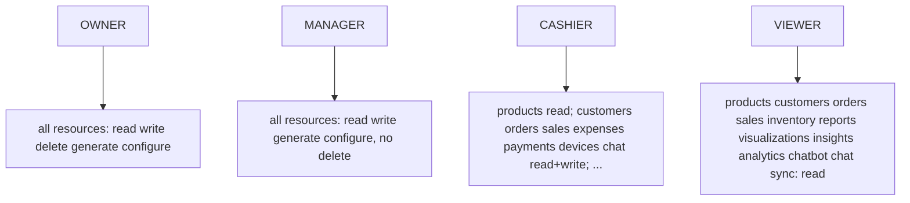

# Authentication and authorization

## Problem overview

Bizworth has two cooperating backend modules: `internal/auth` (identity, JWTs, refresh tokens, OTP, SSO) and `internal/shared/authz` (RBAC over business memberships). Every protected request first authenticates the bearer JWT, then authorizes the action against the caller's role in the current business.

## Current architecture



## Authentication

Password login converges on `Service.issue`, the single choke point for all sign-in methods:

```callstack [Email and password login]
 response = Handler.Login(req) [[backend/internal/auth/handler.go#Login]]
├── user = Repository.FindByEmail(email) [[backend/internal/auth/repository.go#FindByEmail]]
├── bcrypt.CompareHashAndPassword(password, user.PasswordHash)
├── if req.BusinessID: role = MembershipResolver.RoleForUser(businessID, userID)
└── response = Service.issue(userID, businessID, businessID, roles) [[backend/internal/auth/service.go#Service.issue]]
    ├── if businessID == nil: resolved = defaultBusinessForUser(userID) [[backend/internal/auth/service.go#Service.defaultBusinessForUser]]
    ├── accessToken = TokenService.IssueAccessToken(userID, tenantID, businessID, roles) [[backend/internal/auth/token.go#TokenService.IssueAccessToken]]
    ├── rawRefresh, refreshHash, expiresAt = TokenService.NewRefreshToken() [[backend/internal/auth/token.go#TokenService.NewRefreshToken]]
    ├── Repository.CreateRefreshToken(refreshHash) [[backend/internal/auth/repository.go#Repository.CreateRefreshToken]]
    └── profile = Repository.FindByID(userID) [[backend/internal/auth/repository.go#Repository.FindByID]]
```

Access tokens are HS256 JWTs carrying `uid`, `tid`, `bid`, and `roles`, with a 2h default TTL. Refresh tokens are 32 random bytes, stored only as a SHA-256 hash with a 30d TTL and revoked on use (rotation). See `TokenService` in `backend/internal/auth/token.go`.

## Google SSO

Backend supports a direct Google idToken flow and a web OAuth code callback; mobile and web actually use Clerk's Google OAuth and exchange the Clerk JWT at `/auth/clerk`.



`LoginWithGoogle` verifies the id token via Google's tokeninfo endpoint, enforces an optional hosted-domain (`HD`) restriction, then links by provider account id, account table, or email (creating a user if none), upserts `auth_accounts`, ensures a default subscription, and calls `Service.issue`. See `backend/internal/auth/google.go`.

`LoginWithClerk` verifies the RS256 JWT against Clerk's JWKS, fetches all emails on the Clerk account for linking, then follows the same link-or-create path. See `backend/internal/auth/clerk.go`.

## Authorization

`authz.Enforcer` holds a hardcoded policy matrix seeded in `seedDefaults`. `Middleware` requires `userID` and `businessID` in context, resolves the role via `users.Module.RoleForUser`, and checks `Allowed(role, resource, action)`.



Resource and action come from `ResourceAction`, which derives the resource from the chi route pattern (segment after `v1`, with `businesses/.../members` → `members` and `waha` → `whatsapp`) and the action from the HTTP method. See `backend/internal/shared/authz/authz.go`.

## Business scoping

`Service.defaultBusinessForUser` selects the oldest active membership, owner first, so every sign-in method lands on the same business. `Service.issue` applies it when no business was requested. See `backend/internal/auth/service.go`.

## References

- `[[backend/internal/auth/module.go]]`
- `[[backend/internal/auth/service.go]]`
- `[[backend/internal/auth/token.go]]`
- `[[backend/internal/auth/google.go]]`
- `[[backend/internal/auth/clerk.go]]`
- `[[backend/internal/auth/handler.go]]`
- `[[backend/internal/auth/repository.go]]`
- `[[backend/internal/shared/authz/authz.go]]`
- `[[backend/internal/users/module.go]]`
- `[[backend/cmd/api/server.go]]`
- `[[mobile/app/auth/login.tsx]]`
- `[[mobile/contexts/AuthContext.tsx]]`
- `[[web/src/pages/LoginPage.tsx]]`
