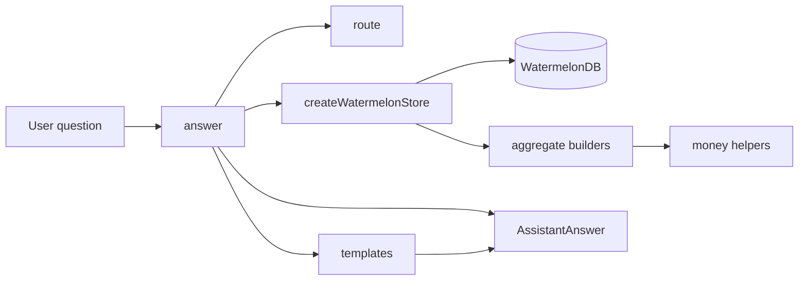
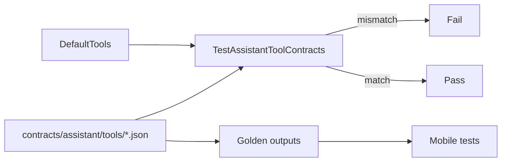

# Offline assistant contracts and deterministic core

## Problem overview

The coach only works online. `CoachPanel` sends every question to `/chatbot/chat`, so a shop owner with no signal gets an error instead of a sales or stock answer. The seven read tools that can answer those questions exist only as Go handlers; their request and response shapes are not checked in anywhere the mobile app can read. There are no golden outputs to test against, and no local code to turn a question into a tool call, a metric card, or a chart.

## Solution overview

Check the seven business-owner tool contracts and golden outputs into `contracts/assistant/`, and guard them with a Go test. Add `mobile/assistant/`, a deterministic core that routes English and Kiswahili questions to those tools, reads WatermelonDB, aggregates in integer minor units, and returns text, cards, and chart data. Nothing in this change calls the network or an LLM.



## Goals

- One checked-in contract for each of the seven offline tools, matching the MCP handler output.
- Deterministic English and Kiswahili answers from local data.
- Tests that fail when a Go tool schema drifts from its contract.
- Answers that carry small, renderable cards and optional bar-chart data instead of a string only.

## Non-goals

- No LLM calls, AG-UI stream, or backend route in this change.
- No coach UI replacement or Gifted Charts dependency.
- No new WatermelonDB tables or migrations.
- No change to the existing `/chatbot/chat` endpoint.

## ✅ Phase 1: Check in tool contracts and golden outputs

**Today**

Tool input schemas live in Go closures. A mobile change can silently disagree with the server about a field name, a limit, or a required value, and no test notices. There are no stable example outputs for templates or future UI work.

**Proposed**

Each tool has a JSON file with the same input schema the backend serves and an explicit output schema. Each has a golden output. The Go test loads every contract and compares its input schema with `DefaultTools`; a drift fails CI before the app reads the wrong field.



The test normalises both sides through JSON so Go numeric types compare with the parsed contract:

```go {3-6}
encoded, _ := json.Marshal(tool.InputSchema)
var actual any
json.Unmarshal(encoded, &actual)

if !reflect.DeepEqual(actual, contract.Input) {
  t.Fatalf("%s: input schema drifted from MCP tool %s", entry.Name(), contract.Name)
}
// [!note L3-L4] Re-encoding removes Go type differences before comparison.
// [!note L6] Descriptions, bounds, and required fields all take part in the check.
```

The seven contracts are `summarize_sales`, `list_sales_by_product`, `list_low_stock_items`, `get_inventory_valuation`, `summarize_expenses_by_category`, `list_invoices`, and `search_customers`. Each fixture pins an example output, including nullable invoice timestamps.

```changes

```

## ✅ Phase 2: Add the deterministic offline core

**Today**

The only path from a question to an answer is `useChat`, which posts to the backend and waits for a 90-second response. Local sales, expenses, stock, invoices, and customers are unreachable from the coach.

**Proposed**

`answer(query, options)` routes the question, executes one local tool, and returns text, metric or list cards, an optional bar chart, and the tool call that produced them. A question about low stock in Kiswahili returns Swahili text from the same local rows that produce the English answer. Unknown questions return a capability sentence with no tool call.

```callstack [One offline question]
 answer = answer(query, options) [[mobile/assistant/answer.ts#answer]]
├── routed = route(query, now) [[mobile/assistant/router.ts#route]]
├── output = store.summarizeSales(args) [[mobile/assistant/watermelonStore.ts#createWatermelonStore]]
│   ├── rows = fetchSales(fromMs, toMs)
│   └── return buildSalesSummary(rows, from, to) [[mobile/assistant/aggregate.ts#buildSalesSummary]]
├── text = salesSummaryText(output, locale) [[mobile/assistant/templates.ts#salesSummaryText]]
└── return { text, cards, tool, locale } [[mobile/assistant/types.ts#AssistantAnswer]]
```

Routing is order-sensitive: low stock and inventory value come before the generic sales rule, and expenses before the sales fallback. Period phrases such as `this month`, `last month`, and `mwezi uliopita` become explicit RFC3339 bounds; with no phrase, the window is the last month, matching the Go default. See `[[mobile/assistant/router.ts#resolvePeriod]]`.

Money never passes through floating-point addition. Each decimal string becomes integer minor units, and totals are formatted back to the string shape the MCP tools return:

```ts {3-5}
for (const line of lines) {
  const current = grouped.get(line.productId) ?? { minor: 0, count: 0 }
  current.minor += parseMoney(line.lineTotal)
  current.count += 1
  grouped.set(line.productId, current)
}
// [!note parseMoney] Scales by 100 and rounds once at the boundary.
// [!note L3] Totals add integers, so 0.10 + 0.20 is exactly 0.3.
```

The Watermelon store mirrors the Go queries: sales exclude `void` and use a half-open date range; product sales group `sale_lines`; low stock compares quantity with its threshold; invoices sort by `created_at` descending; customer search fetches 50 and filters name, phone, and email. It resolves product names for display but leaves the tool output unchanged. See `[[mobile/assistant/watermelonStore.ts]]`.

Across the seven tools the answer builder emits the same contract shapes:

```ts
{
  text: "Between 1 Oct 2026 and 1 Nov 2026 you made 3 sales worth KES 2,900…",
  cards: [{ kind: "metric", label: "Revenue", value: "KES 2,900" }],
  chart: { kind: "bar", title: "Sales by product", series: [{ label: "Maize Flour 2kg", value: 1800 }] },
  tool: { name: "summarize_sales", arguments: { … }, output: { … } },
  locale: "en",
}
// [!note chart] Optional; only product sales and expenses produce one.
// [!note tool] Carries the exact contract output for later AG-UI events.
```

Tests cover route precedence, English and Kiswahili periods, minor-unit arithmetic, nullable invoice dates, customer masking, chart labels, and the unsupported fallback. The fixture outputs drive the answer tests. See `[[mobile/assistant/__tests__/answer.test.ts]]` and `[[mobile/assistant/__tests__/aggregate.test.ts]]`.

```changes

```

## Phase 3: Stream the backend and render the cards

**Today**

The core returns cards, but the coach still renders only remote text. The backend has no AG-UI route, and Gifted Charts is not installed.

**Proposed**

Add `POST /api/v1/chat/stream` in Go, wire it through `xhrHttpStream`, persist threads with WatermelonDB, and render the existing metric, list, and chart payloads with Gifted Charts on native and Expo web. This phase stays planned until the core is reviewed and committed.

## Verification

- `cd mobile && npx tsc --noEmit`
- `cd mobile && npx eslint assistant --ext .ts`
- `cd mobile && npm test` — 32 files, 128 tests.
- `cd backend && go test ./internal/mcp`
- `graphify update .`

## References

- `[[contracts/assistant/tools/summarize_sales.json]]`
- `[[contracts/assistant/fixtures/summarize_sales.json]]`
- `[[backend/internal/mcp/contracts_test.go]]`
- `[[backend/internal/mcp/tools.go]]`
- `[[mobile/assistant/answer.ts]]`
- `[[mobile/assistant/router.ts]]`
- `[[mobile/assistant/watermelonStore.ts]]`
- `[[mobile/assistant/aggregate.ts]]`
- `[[mobile/assistant/templates.ts]]`
- `[[mobile/assistant/money.ts]]`
- `[[mobile/assistant/types.ts]]`
- `[[mobile/vitest.config.ts]]`
